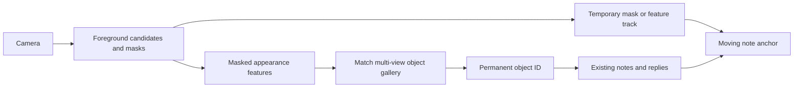

# Object identity independent of room position

Status: proposed architecture, with a reproducible background-leakage experiment.
SAM 2 and DINOv2 are not installed or connected to the running app by this change.
The existing app continues to use SIFT/ORB plus short-lived optical flow.

## Confirmed failure

`MemoryService` currently saves a large centre crop, `InstanceRecognizer.add_reference`
extracts descriptors from every pixel of that crop, and the homography projects the
entire reference rectangle. Walls, furniture, other objects, and the tabletop can
therefore establish the identity. Automatic view banking can reinforce an incorrect
scene identity. Optical flow adds motion continuity but cannot establish which
physical instance has returned after disappearance or a large viewpoint change.

Inspection of local references found a tissue-box reference containing mostly a
chair/table/bags and a bottle reference containing two bottles, a can, and the table.
The note itself remains in SQLite; losing the visual match does not delete it.

A controlled test on the existing bottle reference, using a manually annotated
bottle rectangle, produced:

| Enrollment | Original scene | Bottle crop on new background | Old scene with target region removed |
| --- | --- | --- | --- |
| Existing whole scene | High, score 1.000 | High, score 0.914 | **Incorrect high, score 0.976** |
| Tight bottle crop | High, score 0.967 | High, score 0.984 | Correctly unknown |

These are matcher scores, not probabilities. This is a synthetic cut-and-paste
experiment, not evidence of arbitrary-angle physical-object recognition. It
isolates background leakage; it does not solve rotation, segmentation, occlusion,
or visually identical instances.

Reproduce locally (no DB or reference files are changed):

```sh
uv run python -m scripts.evaluate_object_background \
  --reference PATH_TO_ENROLLMENT.png --bbox X0 Y0 X1 Y1 \
  --output /tmp/object-background-report.json
```

## Recommended pipeline

1. **Select and segment the actual foreground instance.** Use the spoken noun and
   current view to propose a target; ask for a single visual confirmation if
   ambiguous. SAM 2 can turn a point/box prompt into an object mask. Display the
   mask outline briefly so the user can correct a selection. A detector category
   such as `bottle` is only a proposal, never the durable identity. Do not limit
   the design to an 80-class detector: arbitrary tissue boxes and posters matter.
2. **Enroll several masked appearances under the existing object ID.** Capture
   front/side/tilted views and, preferably, a second background. Extract descriptors
   only inside an eroded foreground mask; composite masked crops onto a neutral
   background before embedding. Keep crop, mask, model version, quality, and
   original-source provenance. A low-texture bottle must not pass the quality gate
   merely because its table has many features. Enrollment without enough evidence
   must honestly remain unverified rather than reuse the room.
3. **Re-identify the instance independently of its position.** Compare masked
   candidate embeddings against all saved views. DINOv2 is a candidate visual
   feature backbone, to be evaluated on this object gallery, not a guaranteed
   instance-ID model. Combine embedding similarity with available logo/text/local
   feature evidence and a runner-up margin. Require temporal agreement before
   attaching an existing identity. Calibrate thresholds using moved-object,
   different-background, and lookalike negative examples; do not invent a universal
   cosine threshold. Reject ambiguous, identical-looking copies or ask the user.
4. **Track a temporary instance between identity checks.** Track points inside
   the object mask, or propagate the segmentation mask. This produces a changing
   screen-space shape and an ephemeral track ID. Re-identification maps that track
   back to a permanent `object_id`; optical-flow continuity alone never creates or
   changes that mapping. Refresh masks on keyframes and on significant viewpoint
   change. Keep video rendering independent of inference latency.
5. **Retrieve notes through the permanent ID.** Continue using
   `posts.object_id -> objects.id`. When an object disappears, hide its overlay
   and discard the temporary track. Keep its ID, gallery, and notes. When it is
   recognized elsewhere, create a new temporary track mapped to the same ID and
   retrieve the same thread. Do not use world coordinates, room position, or a
   long-lived tracker handle as the database key for a movable object.



A track transitions `TENTATIVE -> VERIFIED -> TRACKING -> LOST`. Reappearance goes
through `TENTATIVE -> VERIFIED` again; notes persist throughout `LOST`. Position can
help associate adjacent frames but must not decide which saved object returned.

## Storage and API boundary

Add an `object_appearances` table referencing `objects.id`, with masked image path,
mask path, feature vector, encoder/version, source, quality, verification status,
and creation time. Fingerprints that lack a verified foreground mask are marked
legacy; they must not count as trusted multi-view evidence.

Provide a staged capture operation returning a candidate mask and preview, then
an explicit confirmation operation that adds/replaces visual evidence **for the
selected existing object ID**. Capture operations must not add comments. Do not
change titles, post IDs, authors, or reply structure while repairing recognition.
If the user corrects the foreground selection, regenerate appearances rather than
learning the discarded selection as another view.

Automatic view banking should initially be disabled for repaired identities. When
reintroduced, require a validated mask and an independently verified instance,
never only the tracker's confidence or a background-only feature match. Preserve
human-confirmed reference examples so later automatic views cannot evict them.

## Migration of the user's saved objects

Keep every note and object ID. Quarantine scene-heavy legacy views instead of
silently trusting or deleting them. Recapture the bottle and tissue box as object-
only masked references, add alternate angles under their existing IDs, and only
then activate the new recognition index. Existing references may be salvageable
with a manually checked mask, but the tissue box is partly out of its saved photo;
it cannot supply unseen surfaces. Do not promise to recover those from one image.

Persist model versions with features; regenerate an index explicitly when an
encoder changes. A failed migration must leave the old files recoverable and the
notes queryable even if visual recognition is temporarily unavailable.

## Implementation and acceptance order

1. Implement staged foreground selection and mask-aware reference extraction.
2. Repair the two target objects without modifying their notes.
3. Add the multi-view embedding gallery and independent re-identification.
4. Connect mask-restricted tracking to the existing moving overlay.
5. Run physical-camera trials and only then enable verified view banking.

The runtime currently has neither PyTorch nor SAM 2/DINOv2. Benchmark small model
variants on this Mac alongside Whisper/Ollama before choosing inference rates;
published CUDA/A100 speeds are not estimates for this laptop. Run segmentation
and embedding asynchronously, use lower-rate keyframes, cap gallery/proposal
sizes, and keep lightweight motion tracking between expensive checks. Do not
block the live camera stream while recognition runs.

Acceptance trials must include: object moved with static camera; camera tilted or
moved around static object; both moved; object leaving/re-entering elsewhere;
changed background; target removed while old background remains; another similar
bottle in its former position; occlusion; and restart with the same saved thread.
Record ID switches, false matches, recovery rate/time, capture FPS, inference
latency, and preserved post IDs. Passing synthetic optical-flow translation tests
alone is insufficient.

Primary model references:
- SAM 2 image/video segmentation: https://github.com/facebookresearch/sam2
- DINOv2 visual features: https://github.com/facebookresearch/dinov2
